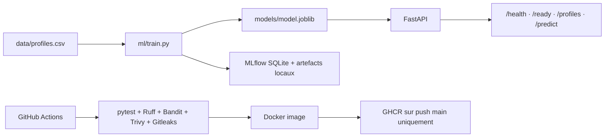

# Mini CRM Intelligence

[](https://github.com/farah-ben-harb/Mlops-Project/actions/workflows/ci.yml)
[](https://www.python.org/)
[](https://github.com/farah-ben-harb/Mlops-Project/pkgs/container/mini-crm-api)

Mini CRM Intelligence est un laboratoire local de classification de profils techniques. Il combine une API FastAPI, un pipeline TF-IDF + Logistic Regression, MLflow, Docker Compose, Ansible, Terraform pour le réseau Docker et une CI GitHub Actions avec contrôles de sécurité.

Le projet est un démonstrateur pédagogique basé sur 30 profils synthétiques équilibrés entre `Backend`, `DevOps` et `MLOps`. Il ne constitue pas une mesure de performance sur des profils réels. Aucun déploiement AWS n'est inclus dans l'état actuel du dépôt.

## Statut du dépôt

- `main` est la branche de référence et la CI est verte sur le dernier commit validé.
- Chaque pull request exécute les tests, Ruff, Bandit, Gitleaks, Trivy, la validation ML et le build Docker.
- Une image immuable est publiée dans [GHCR](https://github.com/farah-ben-harb/Mlops-Project/pkgs/container/mini-crm-api) uniquement après un push réussi sur `main`.
- Le périmètre est volontairement local et pédagogique : aucune ressource AWS n'est créée par le dépôt.

Dernière exécution de référence : [Mini CRM - DevSecOps CI](https://github.com/farah-ben-harb/Mlops-Project/actions/runs/40854348261).

## Architecture



## Fonctionnalités

- `GET /health` : liveness de l'API, sans chargement du modèle.
- `GET /ready` : vérifie que l'artefact du modèle est chargeable.
- `GET /profiles` : trois profils de démonstration en mémoire.
- `POST /predict` : prédit un domaine à partir d'une chaîne de compétences.
- Validation Pydantic des entrées et réponses `503` si le modèle est indisponible.
- Entraînement reproductible avec métriques, baseline, validation croisée et matrice de confusion.
- Suivi MLflow local des paramètres, métriques et artefacts.

## Prérequis

- Python 3.12 pour reproduire exactement la CI et l'entraînement épinglé.
- Docker et Docker Compose pour les conteneurs.
- Git pour le checkout.

Python 3.10 peut exécuter les tests API avec des dépendances compatibles déjà installées, mais peut émettre un avertissement lorsqu'il charge le modèle généré avec une autre version de scikit-learn.

## Installation locale

```bash
python -m venv .venv
source .venv/bin/activate       # Windows : .venv\\Scripts\\Activate.ps1
python -m pip install -r requirements-api.txt -r requirements-dev.txt
```

## Tests et qualité

```bash
python -m pytest -q
python -m ruff check .
```

Les contrôles CI ajoutent Bandit, Gitleaks, Trivy et une construction d'image. La publication GHCR n'est activée que pour un push sur `main` après le passage des contrôles ; aucune publication AWS n'est configurée.

## Contribuer

Consulter [`CONTRIBUTING.md`](CONTRIBUTING.md) avant de créer une branche ou une pull request. Les branches de travail suivent les préfixes `feature/`, `fix/` ou `docs/`. Une pull request doit rester ciblée, documenter les vérifications effectuées et passer tous les contrôles CI avant un squash merge dans `main`.

Pour les incidents de sécurité, suivre [`SECURITY.md`](SECURITY.md) et ne pas publier de secret ou de preuve d'exploitation dans une issue publique.

## Entraînement et MLflow

Installer les dépendances ML puis lancer :

```bash
python -m pip install -r requirements-api.txt -r requirements-ml.txt
python ml/validate_data.py
python -m ml.train
```

Le script écrit `models/model.joblib`, `models/evaluation.json` et `models/confusion_matrix.csv` (ces deux rapports sont des artefacts générés ignorés par Git). Il journalise dans une base SQLite locale par défaut. Pour utiliser un serveur MLflow local, définir `MLFLOW_TRACKING_URI`, par exemple `http://127.0.0.1:5001`.

Les métriques sont calculées sur une partition de test et par validation croisée stratifiée à trois plis. Elles décrivent ce petit dataset synthétique et ne prouvent pas une généralisation à des données réelles.

## API sans Docker

```bash
uvicorn app.main:app --reload
```

Documentation interactive : <http://127.0.0.1:8000/docs>.

Exemple :

```bash
curl -X POST http://127.0.0.1:8000/predict \
  -H 'Content-Type: application/json' \
  -d '{"skills":"Python Docker Kubernetes Terraform"}'
```

## Docker Compose

L'image API contient le modèle et l'image MLflow utilise une base SQLite et un dossier `mlartifacts` montés dans le projet. Le réseau est créé automatiquement par Compose ; Terraform Docker n'est donc pas nécessaire pour un démarrage local simple.

```bash
New-Item -ItemType Directory -Force mlartifacts     # PowerShell
mkdir -p mlartifacts                                # bash
docker build -t mini-crm-api:v1 .
docker build -f Dockerfile.mlflow -t mini-crm-mlflow:v1 .
docker compose up -d
docker compose ps
```

API : <http://127.0.0.1:8002/docs>. MLflow : <http://127.0.0.1:5001>. Les deux ports sont liés à localhost. `docker compose down` arrête les services sans supprimer la base ni les artefacts.

Ansible peut vérifier et démarrer un environnement déjà équipé de Docker avec `ansible-playbook playbooks/site.yml` depuis `ansible/`. Le chemin de projet et l'image doivent être adaptés dans les variables de l'inventaire ; aucun hôte distant n'est provisionné par ce dépôt.

## Sécurité

Les conteneurs utilisent des utilisateurs non-root. Les ports sont liés à localhost par défaut. La CI applique Bandit, Gitleaks et Trivy, avec une exception Gitleaks limitée à l'empreinte du commit utilisée comme tag d'image GHCR. Cette exception ne doit pas servir à masquer un secret. Les secrets AWS et les credentials ne sont pas présents dans le dépôt.

## Structure

```text
app/                 API FastAPI et chargement du modèle
data/                dataset synthétique versionné
ml/                  génération, validation et entraînement
models/              artefact de modèle servant l'API
tests/               tests unitaires et API
ansible/             préflight, déploiement Compose et vérifications
terraform/           réseau Docker local
docs/                audits et plan d'apprentissage AWS
```

## Limitations connues

- Les profils API sont en mémoire et ne constituent pas une base CRM.
- Le dataset est synthétique et très petit ; les scores ne sont pas représentatifs d'un usage réel.
- Le fichier joblib est un artefact binaire qui doit être reconstruit avec les versions épinglées.
- MLflow utilise SQLite et un stockage local : cette configuration n'est pas une architecture multi-instance.
- Le déploiement est local et manuel ; aucune ressource AWS n'est créée par la CI.

## Roadmap

Le plan pédagogique sans exécution Cloud est dans [`docs/AWS_LEARNING_PLAN.md`](docs/AWS_LEARNING_PLAN.md). Les prochaines étapes sont la validation ML sur un jeu indépendant, le durcissement DevSecOps avancé, puis l'apprentissage AWS manuel avec un budget contrôlé.

## Licence

Aucune licence open source n'est déclarée dans le dépôt. Le choix de licence doit être validé par le mainteneur avant toute réutilisation publique du code.
