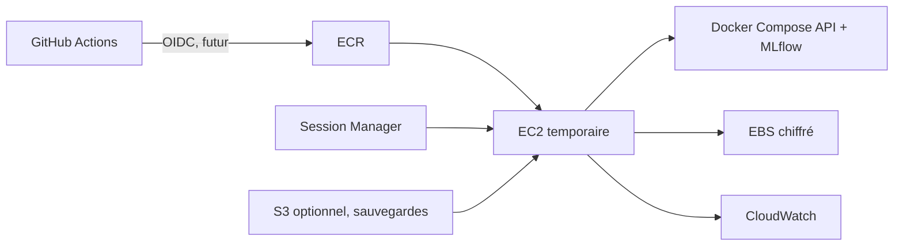

# Plan d'apprentissage AWS — Mini CRM Intelligence

Ce document prépare un apprentissage futur. Il ne contient aucune credential, aucun `terraform apply` AWS et aucun workflow de déploiement Cloud. L'objectif de cette phase est de comprendre les services et de préparer des vérifications avant toute action manuelle.

## Règle financière

La contrainte de ce projet est **0 € facturé**. Aucun service AWS ne peut être considéré comme gratuit par défaut. Avant toute session pratique :

1. Vérifier le type de compte, le pays de facturation, le plan Free/Pay-As-You-Go et l'éligibilité réelle dans la console Billing.
2. Vérifier le solde, la date d'expiration et les conditions des crédits dans Billing > Credits / Cost and Usage.
3. Créer un budget à 0 € avec des alertes à 0 €, puis un budget de sécurité minimal seulement si le compte l'impose.
4. Vérifier la région et toutes les ressources actives avant et après chaque exercice.
5. Supprimer les ressources d'exercice et confirmer les volumes, snapshots, adresses IPv4, load balancers, NAT gateways, endpoints, tâches, bases et journaux restants.

Si le compte exige une conversion vers une offre payante, si les crédits sont absents/expirés, ou si la gratuité ne peut pas être garantie pour le scénario, l'exercice AWS est interdit pour ce projet. Utiliser les alternatives locales ci-dessous.

## Services à apprendre

| Service | Rôle pédagogique cible | Garde-fou avant utilisation |
|---|---|---|
| IAM | Rôles, politiques minimales, séparation humaine/CI/instance | Aucun utilisateur avec clé longue durée ; pas de secret dans Git |
| VPC, subnets, routes, Security Groups | Comprendre les flux réseau et la réduction de surface | Dessiner ports et flux avant toute ressource |
| EC2 + EBS | Héberger temporairement l'API et Compose | Instance arrêtée ou supprimée hors séance ; volume et snapshots contrôlés |
| ECR | Stocker une image immuable par digest | Supprimer les anciens tags/images si l'exercice est terminé |
| Systems Manager | Accès Session Manager sans SSH public | Vérifier agent, rôle d'instance et journaux ; aucun port 22 requis |
| CloudWatch | Logs, métriques, alarmes et rétention | Configurer une rétention courte et surveiller l'ingestion |
| S3 | Sauvegarder artefacts et exports versionnés | Bucket privé, chiffrement, lifecycle et suppression vérifiés |
| ECS/Fargate | Étudier l'orchestration après EC2 | Ne pas créer de cluster ou tâche permanente pour un premier exercice |
| ALB | Comprendre TLS et routage | Éviter un ALB pour une API locale à une seule instance |
| RDS | Comprendre un backend MLflow partagé | SQLite local suffit pour l'apprentissage initial ; RDS reste interdit tant que le coût n'est pas garanti |
| Secrets Manager / Parameter Store | Distribuer une configuration sensible | Ne jamais y placer un secret réel pour ce laboratoire sans budget et rotation définis |

## Architecture cible pédagogique

Le premier scénario AWS, s'il devient autorisé et financièrement garanti, doit rester privé : API et MLflow accessibles via Session Manager/port forwarding, une seule instance, pas d'ALB, pas de NAT Gateway, pas de RDS et pas d'EKS. Cette architecture enseigne IAM, VPC, EC2, EBS, ECR, SSM, CloudWatch et Terraform avec moins de ressources permanentes.

## Prérequis de sécurité

- MFA sur le compte root et aucun usage quotidien du root.
- Rôle humain séparé du rôle GitHub Actions et du rôle EC2.
- GitHub OIDC avec audience et condition `sub` limitées au dépôt, à la branche et à l'environnement autorisés ; aucune clé AWS longue durée dans GitHub.
- Policies IAM minimales : ECR push pour CI, ECR pull et logs pour EC2, SSM pour l'opératrice.
- EBS/S3 chiffrés, bucket privé, blocage de l'accès public et rétention définie.
- Security Group sans SSH entrant ; ports API/MLflow privés tant qu'une authentification et TLS ne sont pas conçus.
- Images identifiées par digest, scans exécutés avant utilisation et logs sans contenu sensible.

## Risques de facturation

Les ressources qui restent provisionnées peuvent coûter même sans trafic : EC2 en marche, EBS, IPv4 publique, ALB, NAT Gateway, endpoints d'interface, RDS, tâches Fargate, snapshots et stockage de logs. ECR, S3 et CloudWatch dépendent aussi du volume stocké, des requêtes, du transfert, de la rétention et de l'ingestion. Les crédits ou offres gratuites sont conditionnels et ne doivent jamais servir de garantie budgétaire.

## Alternatives locales gratuites

- Docker Compose pour simuler API, MLflow, réseau et persistance.
- MinIO local pour une API S3 et des artefacts sans compte Cloud.
- LocalStack uniquement pour des tests d'API AWS ciblés ; il ne reproduit pas la facturation ni toutes les garanties AWS.
- Ansible localhost et Terraform Docker pour pratiquer l'idempotence et l'état sans créer de ressources Cloud.
- GitHub Actions avec jobs de test/scans sans identifiants AWS.
- Kind ou k3d uniquement pour une étude Kubernetes ultérieure, si Docker est disponible.

## Étapes futures, sans exécution

1. Stabiliser `main` et obtenir une CI complète avec tests, Ruff, scans, entraînement et build.
2. Reproduire le modèle et conserver les métriques, hash du dataset, versions et artefacts.
3. Dessiner VPC, ports, rôles et procédure de suppression ; faire relire le budget.
4. Étudier IAM/OIDC et SSM avec la documentation officielle, sans créer de rôle.
5. Comparer les prix de la région choisie dans AWS Pricing Calculator ; abandonner si la gratuité ne peut pas être garantie.
6. Seulement après validation manuelle, réaliser un petit exercice EC2/ECR/SSM et le détruire le même jour.
7. Étudier ECS/Fargate, RDS, S3 et ALB par comparaison documentaire ou environnement local avant toute ressource permanente.

## Critères de passage à AWS

Le projet ne doit passer à une implémentation Cloud que lorsque les points suivants sont vrais : tests et Ruff verts, entraînement reproductible, artefact identifié, procédure de rollback locale, schéma réseau revu, permissions IAM écrites, budget et alertes vérifiés, et procédure `destroy` testée sur une cible isolée. Ces critères sont préparatoires ; ils ne constituent pas une autorisation de créer des ressources.
